---

## Hi, I'm Armielyn

I'm a **Developer Relations** lead, currently **DevRel at [Rise In](https://www.risein.com)**, helping developers go from *"what is this?"* to *"I shipped it."* I work where **AI** and **Web3** meet: I build the sample app, write the guide, run the workshop, and then bring what builders struggled with back to the product team.

- **Now:** DevRel at **[Rise In](https://www.risein.com)**
- **Previously:** Head of DevRel at **TARS AI** and DevRel at **Virtuals Protocol / PathDAO**
- Grew the Southeast Asian developer community: **5,000+ builders onboarded**
- Speaker and presenter at **100+ local and international conferences** across AI and Web3
- Engineer and researcher behind the content: ML Engineer at **Accenture**, Lead ML Engineer at **Omdena** (with UNICEF, ITU and UNDP), and LLM researcher (**NIAI 2026**)

---

## What I do for developers

| Focus | How |
|---|---|
| **Educate** | Hands-on workshops such as **Solidity Fundamentals**, live coding, and docs and tutorials that get you to a working app quickly |
| **Build in public** | Real, open-source sample apps that show a stack end to end, not toy snippets |
| **Grow communities** | Meetups, hackathons and ambassador-style programs across Southeast Asia |
| **Close the loop** | Turning developer feedback, friction logs and user tests into product and docs fixes |
| **Speak** | Conference talks and demos on LLMs, RAG, agents and building on-chain |

---

## Featured: Doqtri — planned vs shipped, proven on-chain

<a href="https://www.doqtri.xyz"><b>doqtri.xyz</b></a> · <a href="https://www.doqtri.xyz/docs">Docs</a> · <a href="https://github.com/armlynobinguar/doqtri">Source</a> · <a href="https://x.com/usedoqtri">@usedoqtri</a>

Write a plan in markdown, and its headings become a mindmap. Link each node to the pull request that shipped it, then anchor every version on **Stellar** so anyone can check what was planned and what shipped.

It's built the way I'd teach it:

- **Onboarding without a crypto extension:** sign up with email and a **passkey** creates a Soroban smart wallet (Face ID, fingerprint or PIN)
- **Proof anyone can check:** public audit pages rebuild each note's history from the ledger
- **Built in public:** weekly "what we shipped" build logs, open docs, MIT licence
- **Tested with real developers:** 50 testers on testnet and 20 on mainnet, and every gap they reported was closed

`Next.js` · `TypeScript` · `Rust / Soroban` · `Stellar SDK` · `Supabase` · `Passkeys`

---

## Speaking & community

- Talks and live demos at **100+ local and international conferences**, from LLMs and RAG to building on-chain
- Facilitated **Solidity Fundamentals** workshops, taking developers from zero to a deployed contract
- Ran developer programs that grew the Southeast Asian builder community

**Inviting me to speak, run a workshop or judge a hackathon?** DM me on [X](https://twitter.com/aeriumcius) or [LinkedIn](https://www.linkedin.com/in/armielyn-obinguar/).

---

## Research

**Split-Brain RAG: Why Large Language Models Are Not Enough for Scientific Question Answering**  
*Armielyn Obinguar & Jodi Moselle Alcantara* — accepted at **NIAI 2026**  
Explores hybrid retrieval-augmented generation for scientific QA and introduces the *Value Ratio* metric for evaluating how faithfully a RAG pipeline answers.

Open to **research collaborations** in LLM interpretability, RAG architectures and agentic systems.

---

## The stack I build and teach with

**AI / LLMs**  

**Web3**  

**Apps & infrastructure**  

---

## Let's work together

- **Projects & foundations:** developer onboarding, docs, sample apps and workshop programs for AI or Web3 developer tools
- **Event organisers:** talks, hands-on workshops and hackathon mentoring or judging
- **Researchers:** collaborations on RAG, LLM interpretability and agentic systems

*"Build in public. Teach what you know. Keep going."*

